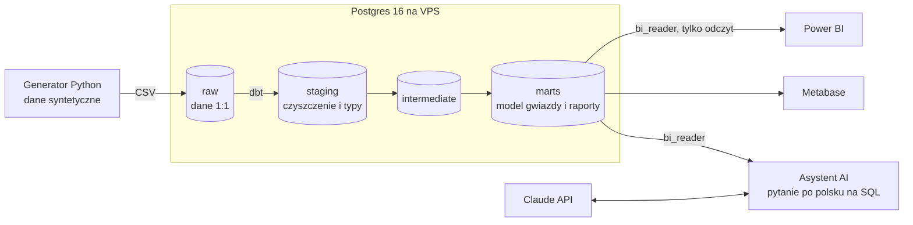
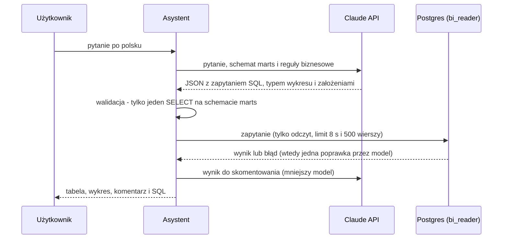

# E-commerce Analytics Stack

**Strona projektu: https://lumijo.pl** · asystent AI: https://lumijo.pl/asystent/ · [raport Power BI](https://app.powerbi.com/view?r=eyJrIjoiNzMwYTVjZjgtOTI4Yy00NmVmLTgwZDctNDc5NzI4MGM1MmZmIiwidCI6IjQ4YzI0NGNmLTU3NjUtNGE1YS1iM2RmLWJlN2Q2NjRlNGNmOCJ9) · [agent Copilot Studio (film)](https://youtu.be/fr-TKNVn5lo)

[](https://github.com/Lukas-Mic/ecommerce-analytics/actions/workflows/dbt-ci.yml)

Kompletny, działający na jednym VPS-ie stos analityczny dla fikcyjnego polskiego sklepu
internetowego: od surowych danych, przez hurtownię i testy jakości, po interaktywny raport
w Power BI i asystenta AI, który odpowiada na pytania o dane po polsku.

Projekt powstał we współpracy z AI (Claude). Sekcja [Jak wykorzystano AI](#jak-wykorzystano-ai)
opisuje, co wygenerowało AI, a co zostało zweryfikowane i poprawione.

## Architektura



| Warstwa | Technologia | Rola |
|---|---|---|
| Źródła | Python (numpy, pandas) | Realistyczne dane z sezonowością, kampaniami i celowymi błędami |
| Hurtownia | PostgreSQL 16 (Docker) | Schematy `raw → staging → intermediate → marts` |
| Transformacje | dbt | 20 modeli, 58 testów, dokumentacja i graf zależności |
| CI | GitHub Actions | pełny `dbt build` i testy asystenta na świeżym Postgresie przy każdej zmianie |
| AI | Claude API, Starlette | asystent: pytanie po polsku → SQL → wynik, wykres i komentarz |
| BI | Power BI, Metabase | Raport Power BI (Publish to web) i self-service BI na tej samej warstwie `marts` |
| Bezpieczeństwo | role Postgres, tunel SSH, Caddy (HTTPS) | Narzędzia BI widzą tylko `marts`, wyłącznie do odczytu |

## Dane

Fikcyjny sklep, październik 2024 - wrzesień 2026: ~12 tys. klientów, ~41 tys. zamówień,
~63 tys. pozycji, 246 produktów w 7 kategoriach, 47 kampanii. Cała baza zajmuje ok. 40 MB.

W danych zaszyte są zjawiska do odkrycia w analizie:

- sezonowość: Black Week, Singles Day (11.11), szczyt przedświąteczny, wyprzedaże,
- sezonowość kategorii: kurtki zimą, ogród wiosną, zabawki w grudniu, artykuły szkolne w sierpniu,
- trend wzrostowy ok. 30% r/r i rosnący udział aplikacji mobilnej,
- moda ma ok. 4x więcej zwrotów niż reszta sklepu (głównie "nie pasuje rozmiar"),
- **incydent 1**: awaria płatności BLIK i kartą 10-12.03.2026 (spadek zamówień, wzrost anulowań),
- **incydent 2**: brak danych kosztowych z Meta 1-5.07.2025.

Marki i adresy e-mail są fikcyjne (domeny `example.*`), a generator jest deterministyczny
(`--seed 42`), więc każdy odtworzy identyczne dane.

## Jakość danych

Surowe dane zawierają typowe problemy produkcyjne. Hurtownia je wykrywa, naprawia
i raportuje w tabeli `marts.dq_data_quality_checks`:

| Problem | Skala | Obsługa |
|---|---|---|
| Duplikaty kont (e-mail z inną wielkością liter/spacjami) | 1,6% klientów | scalenie do `master_customer_id` |
| Konta testowe QA | 12 kont | wykluczone z raportów |
| Niespójne nazwy miast i województw | ~10% / 3% | ujednolicenie |
| Zdublowane wiersze zamówień (błąd ETL) | 0,4% | deduplikacja |
| Cena z przecinkiem dziesiętnym | 1% pozycji | konwersja |
| Pozycje z ilością 0 | 0,07% | odrzucenie |
| Zwroty do odrzuconych pozycji | 3 | ostrzeżenie testu dbt |
| Luka w kosztach Meta | 5 dni | flaga `is_spend_missing` |

## Model danych (`marts`)

| Tabela | Ziarno | Opis |
|---|---|---|
| `fct_orders` | zamówienie | przychód, rabaty, zwroty, marża, numer zamówienia klienta |
| `fct_order_items` | pozycja | produkt w zamówieniu z marżą po zwrotach |
| `fct_returns` | zwrot | powód, czas do zwrotu, kwota |
| `fct_marketing_daily` | dzień x kampania | koszt, CTR, CPC, ROAS, koszt zamówienia |
| `dim_customers` | klient | segmenty wieku, region, kohorta, status, LTV (bez danych osobowych) |
| `dim_products` | produkt | kategoria, marka, przedział cenowy, marża katalogowa |
| `dim_campaigns` | kampania | kanał, typ, rabat, kategoria docelowa |
| `dim_date` | dzień | polskie nazwy, święta ustawowe (seed), dni robocze |
| `rpt_monthly_kpis` | miesiąc | przychód, AOV, marża, CAC, MER, dynamika m/m i r/r |
| `rpt_cohort_retention` | kohorta x miesiąc | retencja i przychód na klienta |
| `rpt_customer_rfm` | klient | segmentacja RFM (Mistrzowie, Lojalni, Zagrożeni...) |
| `dq_data_quality_checks` | kontrola | raport jakości danych |

## Uruchomienie na VPS

Wymagania: Docker z Compose, `make`, ok. 2 GB wolnej pamięci RAM (Metabase ~1,5 GB).

```bash
git clone <repo> && cd ecommerce-analytics
make env          # tworzy .env - ustaw w nim własne hasła
make all          # start kontenerów, generowanie danych, ładowanie, dbt build
make status       # rozmiar bazy i liczba wierszy w marts
make docs         # dokumentacja dbt z grafem zależności: http://localhost:8080
```

Pozostałe polecenia: `make help`.

Metabase działa na `127.0.0.1:3000`. Z własnego komputera otworzysz go tunelem:

```bash
ssh -L 3000:localhost:3000 -L 8000:localhost:8000 -L 15432:localhost:5432 user@twoj-vps
```

Publiczny dostęp przez HTTPS: ustaw `DOMAIN` w `.env`, skieruj rekordy DNS (`@`, `www`, `bi`)
na VPS i uruchom `docker compose --profile public up -d`. Caddy sam pobierze certyfikaty i wystawi:
stronę projektu (`docs/`) pod `https://<domena>/`, asystenta pod `/asystent/` i Metabase pod `bi.<domena>`.

## Asystent AI

Na żywo: **https://lumijo.pl/asystent/**. Lokalnie: `http://localhost:8000` (przez tunel)
działa asystent, który zamienia pytanie po polsku na SQL, wykonuje je w hurtowni i pokazuje
wynik, wykres, komentarz oraz samo zapytanie do weryfikacji.



**Zabezpieczenia:** konto `bi_reader` (tylko `SELECT` na `marts`, transakcje tylko do odczytu),
walidator SQL (jedno zapytanie, bez DDL/DML, bez innych schematów), limit czasu i wierszy,
limit pytań na IP i na dobę. Pytania i wygenerowany SQL trafiają do logu `questions.jsonl`.

**Koszt:** jedno pytanie to ok. 6-8 tys. tokenów; przy domyślnym limicie 100 pytań na dobę
koszt jest ograniczony z góry. Klucz API ustawiasz w `.env` (`ANTHROPIC_API_KEY`).

## Agent Copilot Studio i Power Automate

Osobny moduł w ekosystemie Microsoft: Q&A tracker zespołu due diligence w **Dataverse**,
codzienny raport otwartych pytań z **Power Automate** i agent w **Copilot Studio**, który
sprawdza statusy pytań, dodaje nowe dopiero po potwierdzeniu użytkownika i wyjaśnia pojęcia
na podstawie ściągawki. Film (80 s): https://youtu.be/fr-TKNVn5lo

Opis, konfiguracja agenta, koszty i lista problemów napotkanych w trakcie budowy:
[`power-platform/`](power-platform/README.md).

## Podłączenie narzędzi BI

We wszystkich narzędziach używaj użytkownika **`bi_reader`**: widzi tylko schemat `marts`
i nie może niczego zmienić.

**Power BI Desktop** (Windows, za darmo)
1. Otwórz tunel SSH jak wyżej (Postgres zostaje niewystawiony do internetu).
2. *Pobierz dane → Baza danych PostgreSQL*, serwer `localhost:15432`, baza `warehouse` (port 15432 omija konflikty z zarezerwowanymi portami Windows i lokalnym Postgresem).
3. Tryb **Import**, tabele ze schematu `marts`, relacje faktów z wymiarami po kluczach `*_id` i `date_day`.
4. Power BI zapyta o połączenie bez szyfrowania: przez tunel SSH to bezpieczne, bo ruch i tak jest szyfrowany przez SSH.

**Metabase**: *Admin → Bazy danych → Dodaj*: host `postgres`, baza `warehouse`, użytkownik `bi_reader`.

**Looker Studio**: łączy się z serwerów Google, więc wymaga wystawienia Postgresa na zewnątrz
(SSL i ograniczenie adresów IP). Prostsza alternatywa to eksport tabel `rpt_*` do Arkuszy Google
(planowane w kolejnym etapie).

## Jak wykorzystano AI

Projekt powstał we współpracy z Claude i nie ukrywam tego. Większość kodu napisało AI.
Moja rola to zakres i wymagania, konfiguracja infrastruktury i kont, budowa raportu
Power BI oraz sprawdzanie, czy liczby się zgadzają.

| Etap | Co zrobiło AI | Co zrobiłem ja |
|---|---|---|
| Analiza rynku i zakres | przegląd ofert pracy i popularności narzędzi BI, propozycja architektury | wybór zakresu projektu pod aktualną sytuację na polskim rynku: najpopularniejsze narzędzia (Power BI, SQL), bazy danych i branża (e-commerce) |
| Generator danych | kod generatora, wybór zdarzeń i incydentów (sezonowość, awaria płatności, luka w eksporcie, duplikaty, konta testowe) | weryfikacja, czy dane rzeczywiście zawierają typowe błędy z praktyki, zmiany sezonowe i incydenty; celem był szeroki przekrój potencjalnych problemów do wykrycia w analizie |
| Model danych (dbt) | cały model: warstwy staging/marts, model gwiazdy, testy, dokumentacja | odtworzenie modelu w Power BI: ręczne przypisanie każdej relacji w widoku modelu (z wyłączonym autowykrywaniem), a po wykryciu błędu przebudowa na układ nagłówek-pozycja zamówienia |
| Raport Power BI | miary DAX, motyw, projekt stron, propozycje wniosków | budowa obu stron, formatowanie, kontrola wartości na wizualizacjach, pierwsze wersje wniosków, publikacja przez Publish to web |
| Weryfikacja | testy dbt, testy asystenta, CI w GitHub Actions | porównanie wyników z trzech źródeł: obliczeń modelu AI na jego lokalnej kopii hurtowni, odpowiedzi asystenta AI (Claude API) na hurtowni na VPS oraz Power BI na danych importowanych; przychód netto zgadza się co do grosza (16 026 992,44 zł) |
| Infrastruktura | skrypt konfiguracji serwera, Docker Compose, Caddy, instrukcje | czysta reinstalacja VPS, klucze SSH na dwóch komputerach, przeniesienie domeny (DNS w MyDevil, nie w GoDaddy), certyfikaty HTTPS, hasła i uprawnienia, klucz Claude API z limitem wydatków |
| Konto Power BI | opcje publikacji i ich koszty | darmowa ścieżka zamiast płatnego Microsoft 365: konto na własnej domenie, przejęcie administracji dzierżawy przez rekord DNS, włączenie Publish to web |
| Asystent AI | kod aplikacji, zabezpieczenia, testy | wdrożenie na serwerze, testy na prawdziwych pytaniach i ocena odpowiedzi |
| Agent Copilot Studio | projekt tabeli, przepływu i agenta, instrukcje krok po kroku, diagnoza błędów ze zrzutów ekranu | konfiguracja dzierżawy, licencji i rozliczeń, budowa w Power Platform, testy zachowania agenta (wykryty zapis bez potwierdzenia), weryfikacja wierszy w Dataverse, nagranie |

### Co wyszło przy weryfikacji

| Problem | Jak wyszedł | Co zmieniono |
|---|---|---|
| Ta sama marża (44,8%) dla każdej kategorii produktów | macierz w Power BI pokazywała identyczne wartości we wszystkich wierszach; filtr kategorii nie docierał do miar liczonych z nagłówków zamówień | pozycje zamówień połączone z nagłówkiem, miary sprzedażowe liczone z pozycji; marża od 33,8% (Elektronika) do 58,1% (Moda) |
| Dynamika r/r +62% | porównanie z wynikiem z hurtowni; przy pełnym zakresie dat Power BI porównywał 24 miesiące z 12 | nowa miara liczona tylko na porównywalnych okresach: +35,0% |
| Liczba dni z anomalią o 1 wyższa niż wartość kontrolna (17 zamiast 16) | zauważone przy porównaniu karty w Power BI z wartościami z hurtowni | przyczyną było 20 zamówień z wadliwymi pozycjami: jeden dzień przeszedł przez próg (z = −3,01 zamiast −2,99); wniosek o wrażliwości sztywnego progu trafił do raportu |
| Wyniki na stronie anomalii ok. 60% za niskie | szczyt Black Friday 2025 na wykresie ok. 110 zamówień, w hurtowni 264 | zaznaczone pozycje fragmentatora ukryte poza widocznym obszarem listy; filtr usunięty |
| Fałszywe anomalie na początku danych | dni z października 2024 oznaczone jako spadki | miara z-score liczona dopiero przy pełnych 28 dniach historii |
| Pusty komentarz asystenta przy dużych wynikach | test pytania zwracającego 126 wierszy | model zużywał limit odpowiedzi na fazę rozumowania; podniesione limity i log ostrzeżeń |
| Pojedynczy klienci z blisko 200 zamówieniami | kontrola rozkładów po pierwszym wygenerowaniu danych | przycięty rozkład skłonności do zakupów (maks. ok. 45 zamówień w 2 lata) |
| Zwroty powiązane z odrzuconymi pozycjami zamówień | test relacji w dbt | udokumentowane jako ostrzeżenie i w raporcie jakości danych zamiast ukrycia |

## Plan rozwoju

- [x] Raport Power BI (model gwiazdy, miary DAX, strona jakości danych) + publikacja *Publish to web*
- [ ] Dashboardy Metabase (zarządczy, marketing, klienci)
- [ ] Looker Studio na eksporcie do Arkuszy Google
- [ ] Raport w Excelu odświeżany przez Power Query
- [x] Asystent AI: pytania po polsku → SQL → wykres (z podglądem zapytania)
- [ ] Automatyczny tygodniowy komentarz do wyników i wykrywanie anomalii
- [x] Agent Copilot Studio z narzędziami Dataverse i raport z Power Automate
- [x] CI z `dbt build` w GitHub Actions
- [ ] Harmonogram odświeżania (cron)
- [ ] Strona portfolio z opisem projektu

## Struktura repozytorium

```
├── generator/generate_data.py   # generator danych syntetycznych
├── warehouse/
│   ├── init/01_init.sh          # schematy i role (przy pierwszym starcie Postgresa)
│   └── load_raw.sql             # ładowanie CSV -> raw
├── dbt/
│   ├── models/staging/          # czyszczenie i typowanie
│   ├── models/intermediate/     # wzbogacenie pozycji zamówień
│   ├── models/marts/            # core, marketing, reporting, quality
│   ├── seeds/pl_holidays.csv    # polskie święta 2024-2026
│   ├── tests/                   # testy rekoncyliacyjne
│   └── macros/
├── .github/workflows/dbt-ci.yml # CI: dbt build przy każdej zmianie
├── scripts/setup_vps.sh         # konfiguracja świeżego VPS
├── tools/Dockerfile             # obraz z dbt i generatorem
├── assistant/                   # asystent AI (Starlette + Claude API) z testami
├── powerbi/                     # miary DAX (TMDL), motyw, projekt stron raportu
├── power-platform/              # Q&A tracker: Dataverse, Power Automate, agent Copilot Studio
├── caddy/Caddyfile              # HTTPS dla Metabase i asystenta (opcjonalnie)
├── docker-compose.yml
└── Makefile
```
