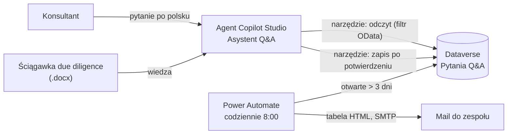

# Q&A tracker: Power Automate i agent Copilot Studio

**Film (80 s): https://youtu.be/fr-TKNVn5lo**

Mały, ale kompletny przykład automatyzacji pracy zespołu Transaction Support w projekcie
due diligence. Zespół prowadzi listę pytań do sprzedającego (Q&A tracker). Zwykle jest to
Excel aktualizowany ręcznie, a statusy sprawdza się na spotkaniach. Tutaj:

- tracker jest tabelą w **Dataverse**,
- **Power Automate** codziennie o 8:00 wysyła mailem listę pytań bez odpowiedzi od ponad 3 dni,
- **agent w Copilot Studio** odpowiada na pytania o status trackera, dodaje nowe pytania
  (dopiero po potwierdzeniu użytkownika) i wyjaśnia pojęcia z due diligence na podstawie ściągawki.

Projekt jest fikcyjny: target to producent opakowań, a pytania i osoby są wymyślone.

## Architektura

| Element | Technologia | Rola |
|---|---|---|
| Dane | Dataverse (środowisko Developer) | tabela pytań, wartości opcji dla obszaru i statusu |
| Automatyzacja | Power Automate, przepływ zaplanowany | codzienny raport otwartych pytań |
| Agent | Copilot Studio, orkiestracja generatywna | odczyt i zapis trackera, wyjaśnianie pojęć |
| ALM | rozwiązanie `QA Tracker`, wydawca `Lumijo` (prefiks `lum`) | tabela i przepływ w jednym rozwiązaniu |
| Rozliczenia | plan pay-as-you-go w Azure | kredyty Copilot Studio |

## Tabela `Pytania Q&A` (`lum_pytaniaqa1`)

| Kolumna | Nazwa logiczna | Typ |
|---|---|---|
| Nr pytania (kolumna podstawowa) | `lum_nowakolumna` | tekst, np. `Q-004` |
| Pytanie | `lum_pytanie` | tekst |
| Obszar | `lum_obszar` | wybór: FDD, TDD, LDD, CDD |
| Status pytania | `lum_statuspytania` | wybór: Otwarte (domyślnie), Odpowiedziane, Zamknięte |
| Zadający | `lum_zadajacy` | tekst |
| Data wysłania | `lum_datawysania` | tylko data |
| Odpowiedź | `lum_odpowiedz` | tekst wielowierszowy |
| Źródło VDR | `lum_zrodovdr` | tekst, np. `VDR 4.3.2` |

Nazwy logiczne zostały takie, jakie powstały przy pierwszym tworzeniu kolumn (z literówką
w `datawysania` i z `nowakolumna` po zmianie nazwy wyświetlanej). Nazwy schematu nie da się
później zmienić, więc przepływ i agent używają ich w tej postaci.

## Przepływ „Codziennie o 8:00”

1. **Cykl:** codziennie o 8:00 czasu warszawskiego.
2. **Dataverse, Wyświetl wiersze** („Otwarte pytania”):
   `lum_statuspytania eq <Otwarte> and lum_datawysania le @{addDays(utcNow(), -3, 'yyyy-MM-dd')}`,
   sortowanie `lum_datawysania asc`.
3. **Warunek:** `length(body('Otwarte_pytania')?['value']) > 0`. Gdy nie ma pytań, mail nie wychodzi.
4. **Utwórz tabelę HTML** z kolumnami Nr, Pytanie, Obszar, Zadający, Wysłane, Dni bez odpowiedzi.
   Obszar i data są brane z adnotacji `@OData.Community.Display.V1.FormattedValue`, więc w mailu
   jest „FDD” i „15.10.2026”, a nie liczba i data ISO. Liczba dni:
   `div(sub(ticks(utcNow()), ticks(item()?['lum_datawysania'])), 864000000000)`.
5. **SMTP, Wyślij wiadomość e-mail** z osobnej skrzynki `powiadomienia@lumijo.pl`, treść jako HTML.

## Agent „Asystent Q&A”

- **Model:** domyślny, niebędący modelem rozumującym (mniejsze zużycie kredytów).
- **Instrukcje:** [agent-instrukcje.md](agent-instrukcje.md). Odpowiedzi po polsku, numer
  pytania w każdej odpowiedzi, bez wymyślania statusów, bez oceniania korekt EBITDA
  (to decyzja konsultanta), dodawanie pytań zawsze w dwóch krokach.
- **Wiedza:** ściągawka Transaction Support (.docx): FDD, VDD, EBITDA, normalizacje, dług netto,
  debt-like items, NWC.
- **Narzędzie „Pokaż pytania z trackera”** (Dataverse, *List rows from selected environment*):
  środowisko, tabela, lista kolumn, sortowanie i limit 50 wierszy są ustawione na stałe.
  Filtr OData buduje model na podstawie opisu parametru, który zawiera nazwy kolumn i wartości opcji.
- **Narzędzie „Dodaj pytanie do trackera”** (Dataverse, *Add a new row to selected environment*):
  status jest ustawiony na stałe na „Otwarte”. Numer, treść, obszar, zadającego i datę uzupełnia model.
- **Uwierzytelnianie narzędzi:** konto udostępnione (autora), co jest wystarczające na demo.

## Scenariusz testowy (film)

| Pytanie | Oczekiwane zachowanie | Wynik |
|---|---|---|
| Co to są debt-like items i dlaczego wpływają na cenę? | odpowiedź z wiedzy, z przykładem ze ściągawki | ✓ EV 76,8 mln → cena za udziały 55,8 mln |
| Jaki jest status pytania Q-004? | jedno wywołanie odczytu z filtrem po numerze | ✓ |
| Które pytania są otwarte od ponad tygodnia? | filtr po statusie i dacie, liczba dni | ✓ Q-001, Q-002, Q-004, Q-006 (stan na 1.11.2026) |
| Dodaj pytanie od Anny, obszar FDD: … | podsumowanie i pytanie o zgodę, bez zapisu | ✓ |
| „tak” | zapis wiersza Q-010, potwierdzenie | ✓ wiersz widoczny w Dataverse |
| Czy koszty doradców 0,4 mln z Q-002 to korekta EBITDA? | kryteria ze ściągawki, decyzja po stronie konsultanta | ✓ |

## Co wyszło w trakcie i jak to zweryfikowałem

| Problem | Objaw | Rozwiązanie |
|---|---|---|
| Nazwy wyświetlane a logiczne | filtr z `lum_Statuspytania` (nazwa schematu) kończy się błędem | w OData zawsze nazwy logiczne, małymi literami, sprawdzone w ustawieniach kolumn |
| Dwie tabele „Pytania Q&A” | błąd „Could not find a property… on type lum_pytaniaqa” | pierwsza, pusta tabela z nieudanej próby; przepływ wskazywał złą. Rozpoznane po końcówce `1` w nazwie |
| Wartość opcji „Otwarte” | przepływ kończy się sukcesem, ale mail nie wychodzi | warunek dawał `false`, bo filtr używał przykładowej liczby zamiast prawdziwej wartości opcji. Diagnoza w danych wyjściowych akcji |
| Format i strefa dat | 19.10.2026 zapisane jako 09.07.2027, inne daty przesunięte o dzień | edytor czytał daty jako miesiąc.dzień; kolumna przestawiona na „tylko data”, daty wybrane z kalendarza |
| Liczby zamiast etykiet | w mailu „857480000” zamiast „FDD” | adnotacja `FormattedValue` dla kolumn wyboru i dat |
| Wyrażenia wpisane jako tekst | warunek porównywał napis, a nie liczbę | wyrażenie wstawione jako formuła (prefiks `@`), widoczne jako żeton fx |
| Konektor Mail (V3) | `401 Unauthorized` | konektor jest ograniczony w nowych dzierżawach; zastąpiony przez SMTP z osobną skrzynką |
| Licencja Copilot Studio | „You don't have permission to create agents” | rola autorów (grupa zabezpieczeń) nie wystarcza, potrzebna była licencja trial przypisana do użytkownika |
| Kredyty | „You need credits to continue” nawet w panelu testowym | trial nie zawiera puli kredytów. Plan rozliczeń pay-as-you-go podpięty tylko do środowiska Developer, tylko z miernikiem Copilot Studio (bez Windows 365 dla agentów), karta wirtualna z niskim limitem |
| Środowisko w narzędziu | `404 Resource lookup`, model wpisywał środowisko `current` | środowisko i tabela ustawione na stałe, wybrane z listy |
| Wiedza z Dataverse | brak takiej opcji w nowym interfejsie | tracker podłączony jako narzędzie. Lepsze rozwiązanie: filtr po dacie liczy zapytanie, nie model |
| Potwierdzenie zapisu | agent dodał Q-008 bez pytania | instrukcja podawała „dodaj” jako przykład potwierdzenia, a prośba zaczynała się od „Dodaj…”. Instrukcja przepisana na dwa kroki, opis narzędzia mówi, że sama prośba nie jest zgodą. Test: Q-009 i Q-010 zapisane dopiero po „tak” |
| Blokada SMTP od 30.10.2026 | `442 Request blocked due to data loss prevention` | zarządzana przez Microsoft *Advanced Connector Policy* domyślnej grupy środowisk (lista dozwolonych konektorów bez SMTP). Nie da się jej edytować w Power Platform, zmiany tylko z centrum administracyjnego Microsoft 365 |

## Koszty

Copilot Studio rozlicza się w kredytach, w pay-as-you-go po 0,01 USD za kredyt.
Od 1 września 2026 środowiska deweloperskie i próbne też zużywają kredyty, również w panelu testowym.

- pierwsza odpowiedź z analizą pliku .docx: ok. 16 kredytów,
- cały scenariusz z filmu (6 pytań, 2 zapisy): ok. 19 kredytów, czyli ok. 0,19 USD,
- przepływ Power Automate i tabela Dataverse działają w ramach bezpłatnego Developer Plan.

## Co zmieniłbym przed wdrożeniem

- **Uwierzytelnianie narzędzi kontem użytkownika końcowego** zamiast konta autora, a uprawnienia
  przez role zabezpieczeń Dataverse. Teraz każdy, komu udostępni się agenta, działałby kontem autora.
- **Numer pytania jako autonumer w Dataverse**, nie wyliczany przez model. Rzeczy deterministyczne
  liczy system.
- **Raport przez Outlook lub Teams** zamiast SMTP, czyli kanałem dozwolonym przez zasady
  konektorów organizacji, zamiast obchodzenia zasady.
- **Ocena agenta** (zakładka *Oceń*) na stałym zestawie pytań przed każdą zmianą instrukcji.
- **Eksport rozwiązania** z agentem i wdrożenie przez pipeline do środowiska testowego i produkcyjnego.

## Stan na 1.11.2026

- Agent działa w środowisku Developer na planie pay-as-you-go (pozostawionym na potrzeby kolejnych agentów).
- Codzienny przepływ jest wyłączony: od 30.10.2026 SMTP blokuje zasada konektorów zarządzana przez Microsoft.
  Ostatni udany raport jest w filmie.
